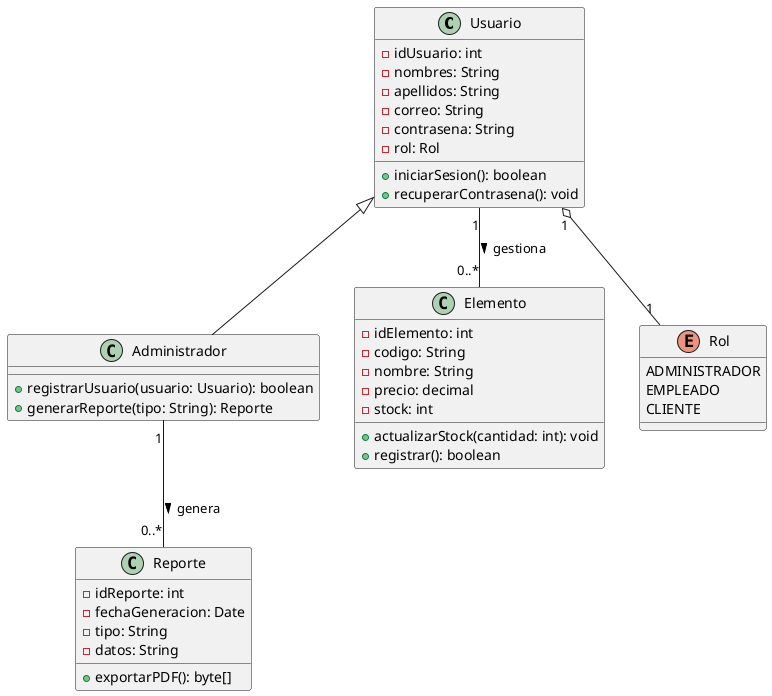
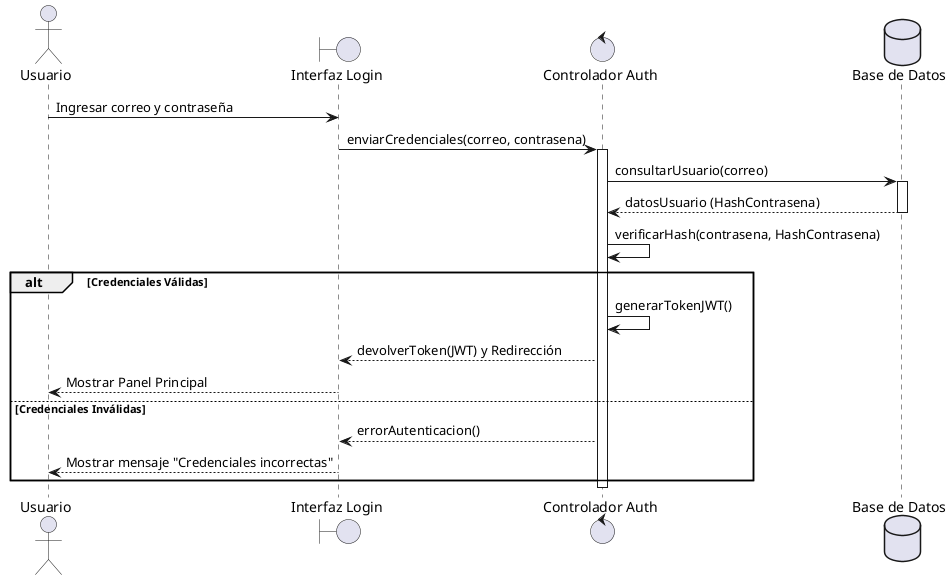

# DOCUMENTACIÓN TÉCNICA DEL SISTEMA: ESPECIFICACIÓN DE FUNCIONES Y DISEÑO DE ARQUITECTURA (UML)

**Programa de Formación:** Análisis y Desarrollo de Software (ADSO)  
**Fase del Proyecto:** Diseño / Desarrollo  
**Entregable:** Documento de Especificación Funcional y Diagramas Arquitecturales  

---

## 1. INTRODUCCIÓN

El presente documento contiene la especificación detallada de las funciones del sistema y la definición de su estructura mediante el lenguaje unificado de modelado (UML). El objetivo es establecer una base sólida para la fase de codificación, permitiendo a los desarrolladores comprender el comportamiento esperado de cada componente, las restricciones de negocio y las interacciones de los actores con el sistema.

---

## 2. ESPECIFICACIÓN EXTENDIDA DE FUNCIONES DEL SISTEMA

A continuación, se describen las funciones principales del software. Cada función se desglosa mediante sus objetivos, datos de entrada, procesos internos, datos de salida y las reglas de negocio aplicables.

### 2.1. Módulo de Autenticación y Control de Acceso

#### FUN-01: Iniciar Sesión (Login)
* **Descripción:** Permite a los usuarios registrados acceder al sistema validando sus credenciales de seguridad.
* **Entradas:** Correo electrónico (String), Contraseña (String criptográfica).
* **Proceso:**
  1. El sistema recibe las credenciales desde la interfaz de usuario.
  2. Se aplica un algoritmo de hash (ej. bcrypt) a la contraseña ingresada.
  3. Se consulta la base de datos para verificar la existencia del usuario y la coincidencia del hash.
  4. Si las credenciales son válidas, se genera un token de sesión (JWT) y se identifica el rol del usuario.
* **Salidas:** Token de acceso, Redirección al panel principal según el rol.
* **Reglas de Negocio:**
  * El sistema debe bloquear la cuenta temporalmente tras tres (3) intentos fallidos consecutivos.
  * La contraseña debe viajar encriptada mediante protocolo HTTPS.

#### FUN-02: Recuperar Contraseña
* **Descripción:** Proporciona un mecanismo para que el usuario restablezca su contraseña en caso de olvido.
* **Entradas:** Correo electrónico (String).
* **Proceso:**
  1. El usuario solicita la recuperación ingresando su correo electrónico.
  2. El sistema valida si el correo existe en el sistema.
  3. Se genera un token único con un tiempo de expiración de 15 minutos.
  4. Se envía un enlace de restablecimiento al correo del usuario.
* **Salidas:** Notificación de envío de correo, Enlace de reajuste.
* **Reglas de Negocio:**
  * No se debe revelar en la interfaz si el correo existe o no por razones de seguridad (mensaje genérico).

---

### 2.2. Módulo de Gestión de Usuarios

#### FUN-03: Registrar Usuario
* **Descripción:** Permite al administrador crear nuevas cuentas de usuarios asignando roles específicos.
* **Entradas:** Nombres (String), Apellidos (String), Documento (Número), Teléfono (String), Correo (String), Rol (Enum).
* **Proceso:**
  1. El sistema valida que los campos obligatorios no estén vacíos.
  2. Se verifica que el correo y el documento no estén registrados previamente.
  3. Se crea el registro en el estado "Inactivo" hasta que el usuario confirme su cuenta.
* **Salidas:** Confirmación de registro exitoso, Correo de activación.
* **Reglas de Negocio:**
  * El número de documento debe ser único en el sistema.
  * Los roles disponibles están limitados a: Administrador, Empleado, Cliente.

| Campo | Tipo de Dato | Obligatorio | Validaciones |
| :--- | :--- | :--- | :--- |
| Nombres | String | Sí | Solo letras, máximo 50 caracteres |
| Correo | String | Sí | Formato de correo válido (@) |
| Documento | Numérico | Sí | Entre 8 y 12 dígitos |
| Rol | Enum | Sí | Debe coincidir con los roles del sistema |

---

### 2.3. Módulo de Gestión de Datos Core (Inventario / Servicios / Procesos)

#### FUN-04: Registrar Elemento / Servicio
* **Descripción:** Permite la inserción de nuevos ítems o servicios dentro del catálogo del sistema.
* **Entradas:** Código único (String), Nombre (String), Descripción (Text), Precio (Decimal), Stock/Disponibilidad (Int).
* **Proceso:**
  1. Recepción de los datos comerciales y técnicos del ítem.
  2. Validación de unicidad del código de barras o código interno.
  3. Persistencia de los datos en la entidad correspondiente de la base de datos.
* **Salidas:** ID de registro generado, Mensaje de confirmación.
* **Reglas de Negocio:**
  * El precio no puede ser igual o inferior a cero.
  * El stock inicial no puede ser un número negativo.

#### FUN-05: Generar Reportes y Estadísticas
* **Descripción:** Compila datos transaccionales para mostrar métricas clave de rendimiento.
* **Entradas:** Fecha Inicio (Date), Fecha Fin (Date), Tipo de Reporte (String).
* **Proceso:**
  1. El sistema realiza una consulta agregada (sumatorias, promedios) en la base de datos delimitada por el rango de fechas.
  2. Los datos se formatean en estructuras JSON aptas para gráficos o archivos planos.
* **Salidas:** Archivo descargable (PDF / Excel), Visualización de datos en dashboard.

---

## 3. MODELADO DE ARQUITECTURA Y DISEÑO (UML)

En esta sección se traduce el comportamiento funcional a diagramas estructurados de UML utilizando la sintaxis de **PlantUML**. Esto permite renderizar los diagramas directamente en Visual Studio Code instalando la extensión correspondiente.

### 3.1. Diagrama de Casos de Uso
Muestra la interacción de los actores externos con las funciones principales del sistema.

```plantuml
@startuml
left to right direction
skinparam packageStyle rectangle

actor "Administrador" as Admin
actor "Usuario Autenticado" as User
actor "Invitado" as Guest

rectangle "Sistema General ADSO" {
    usecase "FUN-01: Iniciar Sesión" as UC_Login
    usecase "FUN-02: Recuperar Contraseña" as UC_Recover
    usecase "FUN-03: Registrar Usuario" as UC_RegUser
    usecase "FUN-04: Registrar Elemento" as UC_RegElem
    usecase "FUN-05: Generar Reportes" as UC_Reports
}

Guest --> UC_Login
Guest --> UC_Recover

User --> UC_Login
User --> UC_RegElem

Admin --> UC_RegUser
Admin --> UC_Reports
Admin --|> User
@ENDUML
```

### 3.2. Diagrama de Clases
Define la estructura de datos orientada a objetos, sus atributos, métodos y las relaciones de cardinalidad.



### 3.3. Diagrama de Secuencia (Proceso de Autenticación)
Modela el intercambio de mensajes entre los objetos del sistema a lo largo del tiempo para el inicio de sesión.



---

## 4. MATRIZ DE TRAZABILIDAD REQUISITOS VS COMPONENTES

Esta tabla permite verificar que cada función del sistema esté debidamente respaldada por una clase y un caso de uso dentro del diseño arquitectónico.

| Código Función | Nombre de la Función | Caso de Uso Asociado | Clase Responsable | Estado de Diseño |
| :--- | :--- | :--- | :--- | :--- |
| FUN-01 | Iniciar Sesión | UC_Login | Usuario / Rol | Aprobado |
| FUN-02 | Recuperar Contraseña | UC_Recover | Usuario | Aprobado |
| FUN-03 | Registrar Usuario | UC_RegUser | Administrador | Aprobado |
| FUN-04 | Registrar Elemento / Servicio | UC_RegElem | Elemento | Aprobado |
| FUN-05 | Generar Reportes y Estadísticas | UC_Reports | Reporte / Administrador | Aprobado |

---

## 5. CONCLUSIONES DE DISEÑO

* **Modularidad:** La separación de funciones por módulos garantiza que las modificaciones futuras en la lógica de negocio de inventarios o reportes no afecten el núcleo de autenticación del sistema.
* **Seguridad Integrada:** Se determina desde la fase de diseño técnico que los datos sensibles (como las contraseñas) jamás se procesarán ni almacenarán en texto plano, aplicando criptografía antes de la persistencia de los datos.
* **Alineación UML:** Los diagramas estructurados sirven como plano técnico directo para la creación de las tablas en la base de datos relacional y para la instanciación de clases en el lenguaje de programación seleccionado (Back-end).
